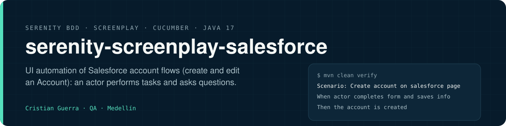
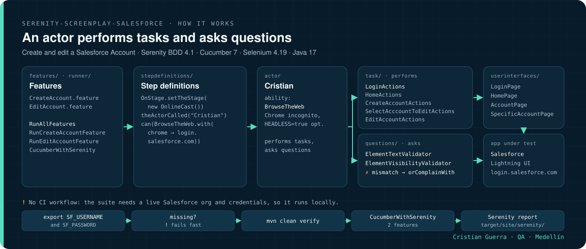

[Read in English](README.md)

<p align="center">
  
</p>

# Serenity Screenplay Salesforce

Automatización de interfaz de los flujos de cuentas de Salesforce (crear y editar una Account) con Serenity BDD y el patrón Screenplay, Cucumber y Selenium WebDriver en Java 17.


## Cómo funciona

<p align="center">
  
</p>

1. Un runner de Cucumber (`CucumberWithSerenity`) toma `CreateAccount.feature` y `EditAccount.feature`.
2. Los step definitions preparan el escenario (`OnlineCast`), llaman al actor `Cristian` y le dan la habilidad `BrowseTheWeb` con Chrome apuntando a `login.salesforce.com`.
3. El actor ejecuta **tareas** (`LoginActions`, `HomeActions`, `CreateAccountActions`, …) armadas con interacciones de Serenity (`Click`, `SendKeys`, `Check`, `WaitUntil`) sobre los **targets** declarados en `userinterfaces/`.
4. El actor hace **preguntas** (`ElementTextValidator`, `ElementVisibilityValidator`) y las valida con `seeThat`; si algo no coincide, se reporta con `orComplainWith` y los mensajes de `Exceptions`.
5. `mvn verify` arma el reporte de Serenity con pantallazos y la narrativa Screenplay.

<p align="center">
  
</p>

La animación recorre paso a paso el camino en el código de `CreateAccount.feature` (también en [MP4](docs/assets/how-it-works.mp4)). No es la grabación de una ejecución: no hay workflow de CI, así que en este repositorio no hay resultados de ejecuciones publicados.

## Qué prueba

| Feature | Escenario | Verifica |
|---|---|---|
| `CreateAccount.feature` | Iniciar sesión, abrir Accounts, llenar el formulario de cuenta nueva y guardar | Texto del aviso de éxito; se muestra el dashboard de la cuenta (encabezado, barra lateral, panel principal) |
| `EditAccount.feature` | Iniciar sesión, escoger una cuenta existente, editar sus datos y guardar | Los valores actualizados aparecen en el detalle de la cuenta |

Corre contra una org de Salesforce (interfaz Lightning) con las credenciales que usted entregue; no hay nada del ambiente subido al repositorio.

## Arquitectura (Screenplay)

- **Actor**: `OnStage` / `OnlineCast` con la habilidad `BrowseTheWeb` sobre una instancia de Chrome configurada.
- **Tareas** (`task/`): `LoginActions`, `HomeActions`, `CreateAccountActions`, `SelectAcccountToEditActions`, `EditAccountActions`; interacciones de negocio compuestas con `Click`, `SendKeys`, `Check` y `WaitUntil` de Serenity.
- **Preguntas** (`questions/`): `ElementTextValidator` y `ElementVisibilityValidator` leen el estado de la interfaz para las aserciones con `seeThat`.
- **Interfaces de usuario** (`userinterfaces/`): definiciones `Target` por página (`LoginPage`, `HomePage`, `AccountPage`, `SpecificAccountPage`).
- **Step definitions** (`stepdefinitions/`): conectan los pasos Gherkin con tareas y preguntas; las `Exceptions` propias dan mensajes de falla legibles con `orComplainWith`.
- **Utilidades** (`utils/`): fábrica del driver, constantes, datos de login, datos de prueba aleatorios y datos para las aserciones.

## Cómo correrlo

Requiere JDK 17, Maven 3.x y Google Chrome (Selenium Manager resuelve el driver).

Las credenciales se leen de las variables de entorno `SF_USERNAME` y `SF_PASSWORD` (o de propiedades `-D`); si faltan, la suite se detiene enseguida con un mensaje claro. Vea `.env.example`.

```bash
git clone https://github.com/criguex/serenity-screenplay-salesforce.git
cd serenity-screenplay-salesforce

export SF_USERNAME="your.user@example.com"
export SF_PASSWORD="your-password"
export HEADLESS=true                              # opcional, por defecto false

mvn clean verify                                  # todos los features + reporte de Serenity
mvn clean verify -Dtest=RunCreateAccountFeature   # un solo feature
mvn clean verify -Dtest=RunEditAccountFeature
```

## Estructura del proyecto

```
.
├── .env.example
├── docs/
│   ├── assets/        banner.svg, how-it-works.svg, how-it-works.gif, how-it-works.mp4
│   └── scenes/        how-it-works.html + export.sh (regenera la animación)
├── pom.xml
├── serenity.properties
└── src/
    ├── main/java/test/accountsalesforce/
    │   ├── exceptions/       Exceptions
    │   ├── questions/        ElementTextValidator, ElementVisibilityValidator
    │   ├── task/             LoginActions, HomeActions, CreateAccountActions, EditAccountActions, ...
    │   ├── userinterfaces/   LoginPage, HomePage, AccountPage, SpecificAccountPage
    │   └── utils/            drivers, constants, data, randomdata, assertiondata
    └── test/
        ├── java/test/accountsalesforce/
        │   ├── runner/           RunAllFeatures, RunCreateAccountFeature, RunEditAccountFeature
        │   └── stepdefinitions/  CreateAccountStepDefinitions, EditAccountStepDefinitions
        └── resources/features/   CreateAccount.feature, EditAccount.feature
```

## Reportes

`mvn verify` corre el plugin de Serenity para Maven después de las pruebas y deja el reporte consolidado en `target/site/serenity/` (`index.html`, más una versión HTML de una sola página) con pantallazos paso a paso, tiempos y la narrativa Screenplay de cada escenario.

## CI

No hay workflow configurado: la suite necesita una org de Salesforce activa y credenciales, así que está pensada para correr en local o desde un pipeline que inyecte `SF_USERNAME` y `SF_PASSWORD` como secretos.

## Límites

- Necesita una org de Salesforce activa y credenciales válidas; sin ellas, la tarea de login se detiene con un mensaje claro.
- `EditAccount.feature` escoge al azar una cuenta de la lista de Accounts, así que la org necesita al menos una cuenta.
- Los datos del formulario son aleatorios en cada ejecución, así que dos ejecuciones no son idénticas.

## Regenerar la animación

`docs/scenes/how-it-works.html` dibuja cada cuadro a partir de `?t=<segundos>`; `docs/scenes/export.sh` captura los cuadros con Chrome headless y arma `how-it-works.gif` y `how-it-works.mp4` con ffmpeg.

---

Cristian Guerra · Senior SDET · [linkedin.com/in/criguex](https://www.linkedin.com/in/criguex)
